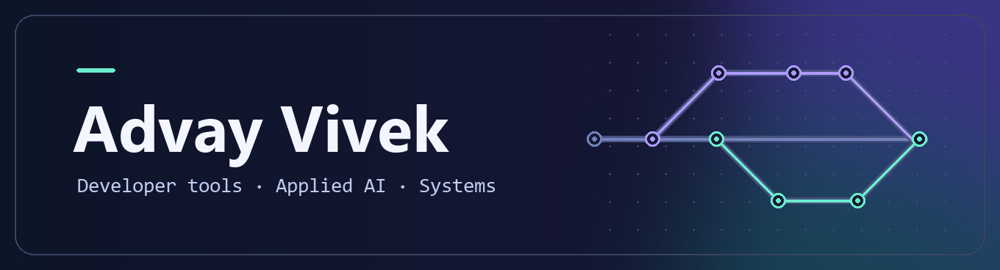

[Open source](#open-source) · [Selected projects](#selected-projects) · [Languages and tools](#languages-and-tools) · [LinkedIn](https://www.linkedin.com/in/advay-v/)

I’m a computer science undergraduate at **VIT Vellore**. I like building tools that make it easier to trace what happened, from a shifted column in a PDF to a scheduling decision in a simulator. During my AI engineering internship at **Coforge**, I worked on retrieval and knowledge graphs for a travel assistant.

## Open source

- **Firecrawl PDF Inspector.** I fixed how the Rust parser handles missing empty cells in tagged PDF tables and added a synthetic regression fixture. [Open PR #679](https://github.com/firecrawl/pdf-inspector/pull/679) · [Table-cell checker](https://github.com/AdvayV/pdf-inspector/blob/portfolio-table-cell-regressions/docs/table-cell-regressions.md)
- **NPCI IndicBankBench.** I isolated candidate-model settings from judge and report requests and added regression tests. [Open PR #4](https://github.com/npci/IndicBankBench/pull/4)

## Selected projects

| Project | What it does | Where to start |
| --- | --- | --- |
| **[CodeStrata](https://github.com/AdvayV/AgenticIntelligence)** | Explores what changed in a codebase over time by indexing its Git history. | [Try the local demo](https://github.com/AdvayV/AgenticIntelligence#try-the-demo) |
| **[LoopOS](https://github.com/AdvayV/LoopOS)** | Makes task scheduling visible through an interactive simulator and a local replay harness. | [Try Crisis Lab](https://advayv.github.io/LoopOS/) |
| **[FinLens](https://github.com/AdvayV/FinLens-on-Reactjs)** | Turns transaction CSVs into spending insights and supports server-calculated loan simulations. | [Dashboard preview](https://github.com/AdvayV/FinLens-on-Reactjs/blob/main/docs/images/dashboard.jpg) |
| **[Serverless Cold-Start Simulator](https://github.com/AdvayV/ServerLess-Arch)** | Compares serverless scheduling and caching policies against seeded workloads. | [540-run study](https://github.com/AdvayV/ServerLess-Arch/blob/main/experiments/REASSESSMENT_STUDY.md) |
| **[CodeMood](https://github.com/AdvayV/Emotion_Detection)** | Compares emotion recognition approaches for Hindi–English and English–French code-mixed text. | [Run the local demo](https://github.com/AdvayV/Emotion_Detection/blob/main/GET_STARTED.md) |

## Languages and tools

| Area | What I’ve worked with |
| --- | --- |
| **Project languages** | Python · JavaScript · TypeScript · Rust |
| **Coursework** | Java · C · C++ |
| **Frontend** | HTML · CSS · React · Next.js · Vite · Chart.js · D3.js |
| **Backend and data** | Node.js · Express · FastAPI · Zod · MongoDB · Mongoose · Neo4j |
| **ML and retrieval** | PyTorch · Hugging Face Transformers · scikit-learn · LangChain · Streamlit |
| **Testing and delivery** | pytest · Playwright · Docker · GitHub Actions |
